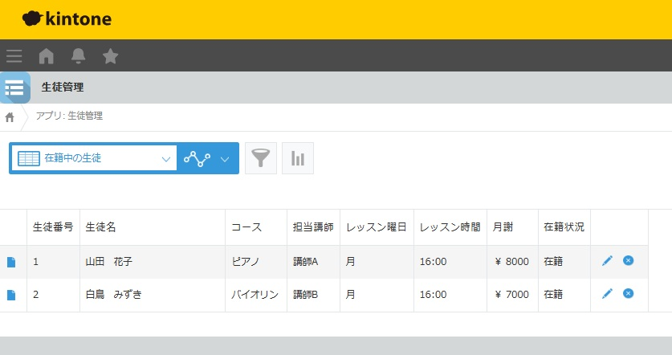

# kintoneで作った音楽教室の受講生管理DB

紙の台帳で生徒情報を管理している音楽教室を想定し、サイボウズのkintoneで受講生管理アプリを試作しました。日々のレッスン前に、在籍中の生徒のコース・担当講師・曜日・時間を一覧で確認できます。

## 設計した機能

- 生徒番号を自動採番します。
- 登録画面を2列に分け、左に生徒と連絡先、右にレッスンと契約の項目を配置しました。
- コース、担当講師、レッスン曜日を選択式にして、表記のばらつきを抑える設計にしました。
- 在籍・休会・退会を管理し、「在籍中の生徒」一覧では在籍のレコードだけを生徒番号順に表示します。

## デモ画面

画像のデータはすべて架空です。音楽教室の業務を想定した試作・検証事例です。
